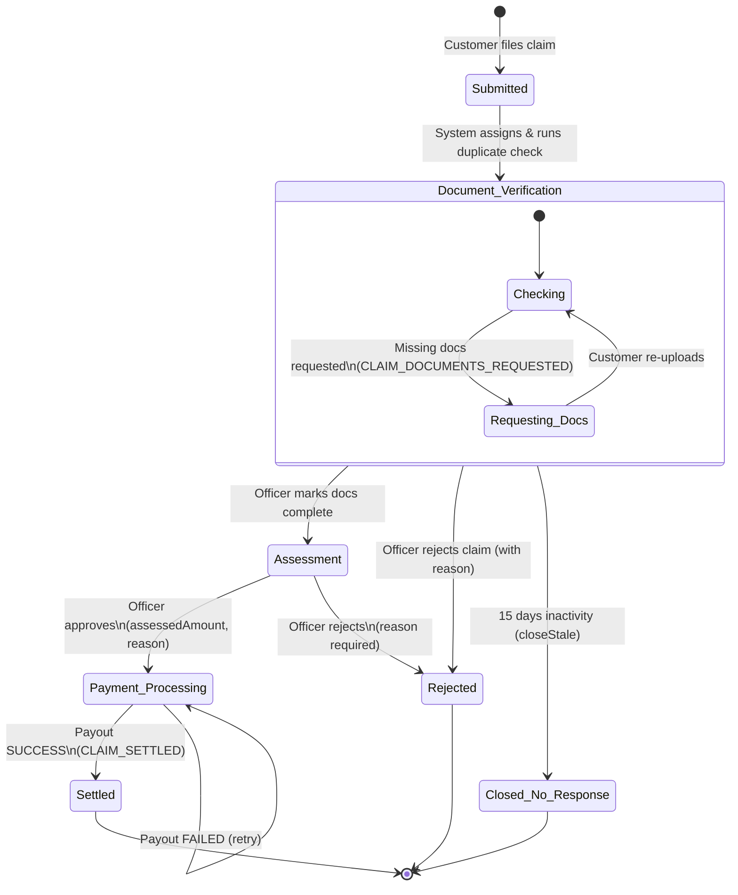

# P4 Contract Specification (P4-03) — Shared Interfaces, Storage, and Test Clock

**Owner:** Person 4 — Raghunandan Kotary (Developer / Environment Owner)  
**Status:** Draft v0.2 — Revised for Team Re-Review (18 October 2026)  
**Tracking Issue:** [#127](https://github.com/Thijil-Thejaswi-MN/Team-11/issues/127)  
**Pull Request:** [#128](https://github.com/Thijil-Thejaswi-MN/Team-11/pull/128)  
**Review History:** Draft v0.1 reviewed by Thijil-Thejaswi-MN (`CHANGES_REQUESTED` on 17 October 2026); revised in v0.2 to reconcile claim workflow states, stale-claim 15-day timeline, duplicate detection, the authoritative 16-event notification catalogue, upload error codes (HTTP 413/415), P1 claim-decision DTO alignment, settled-only `hasPaidClaim()` semantics, clock timestamp consistency, and SAD Table 3.4b method naming.  
**Source of Truth:** SAD v1.0/v1.1 (Sections 3.4b, 4.1.3, 4.1.5, 4.1.6, 4.1.7, 4.3.4, 4.3.5, 4.3.7, 4.4; ADR-005, ADR-007, ADR-008), SRS v1.0 (Sections 4.7.1, INS-F-008, INS-F-012 through INS-F-017, INS-F-023, INS-SR-004, INS-SR-007, UC-24), STP v1.0 (Section 8; test cases TC-Clm-01 through TC-Clm-06, TC-Ntf-01, TC-Sec-07, TC-Can-01/02), P3 Contract Draft v0.3 (`docs/contracts/p3-contract.md`), and P1 API Contract (`docs/api-contract/01-quotes-underwriting-claims-audit.md`).  
**Governance Notice:** This document defines shared contracts, data types, error semantics, and test-clock controls. In accordance with team engineering rules, implementation tasks P4-05 (Test Infrastructure) and P4-06 (Interface Stubs) remain **BLOCKED** until this contract receives explicit approval from all team members.

---

## 1. Scope and Traceability Matrix

| Requirement ID | Module / Component | Responsibility | Authoritative Source | Relevant Test Cases |
|---|---|---|---|---|
| **INS-F-008** | C8 Payment Adapter | Premium charge, gateway abstraction, retry (3x), idempotency | SAD §3.4b, §4.3.4, §4.3.7; ADR-007 | TC-Pay-01, TC-Pay-02, TC-Pay-03 |
| **INS-F-012** | C7 Claims Workflow | Claim filing against active policy within 30 days of incident | SRS §4.7.1, INS-F-012; SAD §4.3.5 | TC-Clm-01 |
| **INS-F-013** | C7 Claims Workflow | Canonical claim state machine enforcement (no skipped states) | SRS §4.7.1; SAD §4.1.3; ADR-008 | TC-Clm-02 |
| **INS-F-014** | C7 Claims Workflow | Verification, assessment, decision (Approve/Reject with reason), settlement | SRS §4.7.1; SAD §4.3.5; P1 Contract §6 | TC-Clm-03, TC-Clm-06 |
| **INS-F-015** | C7 Claims Workflow | Customer claim timeline and status tracking | SRS §4.7.1; SAD §4.3.5 | TC-Clm-04 |
| **INS-F-023** | C7 Claims Workflow | Duplicate detection on entry to Document Verification (manual review flag) | SRS INS-F-023, UC-24; SAD §4.1.3 | TC-Clm-05 |
| **INS-F-016** | C9 Notification Service | Exactly 16 event-driven status notifications (Email/SMS) | SAD §4.1.7, Table 3.4b; ADR-005 | TC-Ntf-01 |
| **INS-F-017** | C10 Scheduler / C9 | Automated renewal reminders (at 30, 15, and 1 day before expiry) | SAD §3.4b, §4.1.6; SRS INS-F-017 | TC-Ren-01 |
| **INS-SR-004** | C12 File Store | Document encryption at rest (AES-256) | SRS INS-SR-004; SAD §3.4b | TC-Sec-04, TC-Sec-11 |
| **INS-SR-007** | C12 File Store | Upload security: max 5 MB (HTTP 413), PDF/JPG/PNG whitelist (HTTP 415), path traversal check | SRS INS-SR-007; SAD §4.3.1; STP TC-Sec-07 | TC-Sec-07, TC-KYC-01 |
| **P4-03 / STP §8**| Test Infrastructure | Injected `Clock`, virtual time control endpoint (`POST /api/v1/test/clock`), profile isolation | STP §8; SAD §4.1.6 | TC-Ren-01, TC-Ren-02, TC-Can-01, TC-Clm-06 |

---

## 2. Shared Architectural Conventions

1. **Package Namespaces:**
   - Payments: `com.team11.insurance.payments`
   - Notifications: `com.team11.insurance.notifications`
   - Claims: `com.team11.insurance.claims`
   - File Storage: `com.team11.insurance.filestore`
   - Clock / Time Infrastructure: `com.team11.insurance.common.time`
2. **Standard API Error Response Format:**
   All endpoints return the uniform error payload defined in SAD §4.4:
   ```json
   {
     "timestamp": "2026-10-18T10:00:00Z",
     "status": 402,
     "errorCode": "PAY-402",
     "message": "Payment processing failed; retry allowed",
     "details": [{ "field": "payment", "issue": "Card declined by issuer" }],
     "correlationId": "c0a801-12345-67890"
   }
   ```
   **Standard HTTP Status & Error Code Registry:**
   - `400 / 422 VALID-422`: Business rule validation failure (e.g. claim filed > 30 days after incident).
   - `401 AUTH-401`: Missing, expired, or invalid session token.
   - `403 ACCESS-403`: Insufficient role or cross-insurer data access violation.
   - `404 NOTFOUND-404`: Record not found or not visible to caller.
   - `409 STATE-409`: Illegal state transition (e.g. deciding an unverified claim, settling unapproved claim).
   - `402 PAY-402`: Payment charge, refund, or payout failure (retryable).
   - `413 FILE-413` (or `VALID-413`): Uploaded file exceeds maximum allowed limit of 5 MB (STP TC-Sec-07).
   - `415 FILE-415` (or `VALID-415`): Disallowed media type (non-PDF/JPG/PNG or executable/disguised file, STP TC-Sec-07).
   - `423 AUTH-423`: Account locked after 5 consecutive failed login attempts (15 min).
   - `500 SYS-500`: Unexpected internal server error with masked details.
3. **Identity and Security Scoping:**
   - Identity resolved strictly via server-side security context (`CurrentUser { userId, role, insurerId }`).
   - Insurer staff (`INSURER_ADMIN`, `UNDERWRITER`, `CLAIMS_OFFICER`) are strictly isolated: `claim.insurerId == currentUser.insurerId`.
   - Customers (`CUSTOMER`) are strictly isolated: `claim.customerId == currentUser.userId`.
4. **Time Invariant and Clock Injection:**
   - **Zero direct system time calls:** Domain logic must never invoke `System.currentTimeMillis()`, `LocalDate.now()`, or `Instant.now()` directly.
   - All temporal computations (policy issuance, 15-day free-look window, 30/15/1-day renewal notices, 15-day stale claim closure) read from an injected `java.time.Clock`.

---

## 3. Section A — Payment Service Contract (`IPaymentService`)

Component C8 acts as an adapter isolating core insurance modules from external payment gateways (SAD Table 3.4b, §4.3.4, §4.3.7; ADR-007).

### 3.1 Java Interface Definition

Aligned with SAD Table 3.4b ("Key operations: `charge, refund, payout, getStatus`"):

```java
package com.team11.insurance.payments;

import java.math.BigDecimal;

/**
 * Payment Adapter Interface (Component C8 - SAD Table 3.4b & ADR-007).
 * Consumed by: Quote & Purchase (C5/C7), Policy Renewal/Cancellation (C7), Claims Workflow (C7/C10).
 */
public interface IPaymentService {

    /**
     * Charges a customer for an approved application premium or renewal.
     *
     * @param applicationId  the ID of the insurance application being purchased
     * @param amount         monetary amount in INR (whole rupees, >= 1)
     * @param idempotencyKey server-generated key: "applicationId-attemptNo"
     * @return PaymentResult indicating SUCCESS or FAILED outcome
     */
    PaymentResult charge(long applicationId, BigDecimal amount, String idempotencyKey);

    /**
     * Refunds a customer following an approved policy cancellation.
     *
     * @param policyId       the ID of the cancelled policy
     * @param amount         refund amount calculated per STP test oracle (Rs 0 skips gateway)
     * @param idempotencyKey server-generated key: "cancel-policyId-requestId"
     * @param reason         cancellation justification recorded for audit
     * @return PaymentResult indicating SUCCESS or FAILED outcome
     */
    PaymentResult refund(long policyId, BigDecimal amount, String idempotencyKey, String reason);

    /**
     * Disburses an approved claim settlement to the customer.
     *
     * @param claimId            the ID of the approved claim
     * @param assessedAmount     the approved settlement amount in INR
     * @param idempotencyKey     server-generated key: "claim-claimId-payout"
     * @param destinationAccount masked bank account / UPI ID
     * @return PaymentResult indicating SUCCESS or FAILED outcome
     */
    PaymentResult payout(long claimId, BigDecimal assessedAmount, String idempotencyKey, String destinationAccount);

    /**
     * Queries payment status by idempotency key (SAD Table 3.4b getStatus).
     *
     * @param idempotencyKey the idempotency key of the payment attempt
     * @return PaymentResult for the attempt, or throws ResourceNotFoundException
     */
    PaymentResult getStatus(String idempotencyKey);
}
```

### 3.2 Payment Data Models and Clock-Safe Factories

In compliance with the injected-clock invariant, `PaymentResult` factory methods accept either an explicit `Clock` or an explicit processing timestamp:

```java
package com.team11.insurance.payments;

import java.math.BigDecimal;
import java.time.Clock;
import java.time.Instant;

public record PaymentResult(
    Long paymentId,
    PaymentStatus status,
    String idempotencyKey,
    String transactionReference,
    BigDecimal amount,
    PaymentType type,            // CHARGE, REFUND, PAYOUT
    Instant processedAt,
    String failureReason,        // null on SUCCESS
    String errorCode             // null on SUCCESS, e.g. "PAY-402"
) {
    public static PaymentResult success(Long paymentId, String key, String ref, BigDecimal amount, PaymentType type, Clock clock) {
        return new PaymentResult(paymentId, PaymentStatus.SUCCESS, key, ref, amount, type, clock.instant(), null, null);
    }

    public static PaymentResult success(Long paymentId, String key, String ref, BigDecimal amount, PaymentType type, Instant processedAt) {
        return new PaymentResult(paymentId, PaymentStatus.SUCCESS, key, ref, amount, type, processedAt, null, null);
    }

    public static PaymentResult failed(Long paymentId, String key, BigDecimal amount, PaymentType type, String reason, String code, Clock clock) {
        return new PaymentResult(paymentId, PaymentStatus.FAILED, key, null, amount, type, clock.instant(), reason, code);
    }

    public static PaymentResult failed(Long paymentId, String key, BigDecimal amount, PaymentType type, String reason, String code, Instant processedAt) {
        return new PaymentResult(paymentId, PaymentStatus.FAILED, key, null, amount, type, processedAt, reason, code);
    }
}

public enum PaymentStatus {
    SUCCESS,
    FAILED,
    PENDING
}

public enum PaymentType {
    CHARGE,
    REFUND,
    PAYOUT
}
```

### 3.3 Transaction & Idempotency Rules (ADR-007)

1. **Idempotency Key Generation:**
   - Client **never** generates or supplies the idempotency key; it is minted strictly by the server controller (`applicationId + "-" + attemptNo`).
2. **Duplicate Protection:**
   - Payment table enforces a `UNIQUE(idempotency_key)` database constraint.
   - If `charge()` is invoked with an existing key and previous outcome was `SUCCESS`, it immediately returns the persisted `PaymentResult` without re-invoking the external gateway.
3. **Autonomous Transaction Scope (`REQUIRES_NEW`):**
   - Payment records and audit rows execute in an independent transaction, ensuring records are preserved even if downstream policy issuance encounters a subsequent error.
4. **Retry Behavior (INS-F-008 / SAD §3.4b):**
   - On gateway timeout or network disconnect, the adapter automatically retries up to 3 times with exponential backoff (1s, 2s, 4s) using the **exact same** `idempotencyKey`.
   - Business rejections (e.g. card declined, insufficient funds) return `FAILED` immediately without retry.
5. **Zero-Amount Refund Rule (P3 Contract §3.5 & Decision D-09.3):**
   - When calculated cancellation refund is `BigDecimal.ZERO` (e.g. policy has settled claims), `refund()` records a zero-amount `REFUND` with status `SUCCESS` and skips calling the external payment gateway.

---

## 4. Section B — Notification Service Contract (`INotify`)

Component C9 delivers asynchronous notifications across Email and SMS channels with multi-channel fallback and audit logging (SAD Table 3.4b, §4.1.7; ADR-005).

### 4.1 Java Interface Definition

Aligned with SAD Table 3.4b ("`send(event, recipient, params)`"):

```java
package com.team11.insurance.notifications;

import java.util.Map;

/**
 * Notification Service Interface (Component C9 - SAD Table 3.4b, §4.1.7 & ADR-005).
 * Consumed by: Quote & Purchase (C5), Claims Workflow (C7), Scheduler (C10).
 */
public interface INotify {

    /**
     * Canonical signature per SAD Table 3.4b.
     *
     * @param event           authoritative notification event from SAD §4.1.7
     * @param recipientUserId destination user primary key
     * @param params          dynamic template parameters (policyNo, claimNo, amount, etc.)
     */
    void send(NotificationEvent event, long recipientUserId, Map<String, String> params);

    /**
     * Overloaded DTO method supporting enriched routing (email, phone, channel).
     * Guaranteed non-blocking to the caller's database transaction.
     *
     * @param request structured notification request
     */
    void send(NotificationRequest request);
}
```

### 4.2 The Authoritative 16-Event Catalogue (SAD §4.1.7)

In strict accordance with SAD §4.1.7 and STP TC-Ntf-01 ("all 16 events in SAD 4.1.7"):

```java
package com.team11.insurance.notifications;

public enum NotificationEvent {
    // 1. Quotes & Underwriting (C5/C6)
    APPLICATION_APPROVED,      // Underwriting approves, or Underwriter manually approves
    APPLICATION_REFERRED,      // Underwriting gives Refer
    APPLICATION_REJECTED,      // Underwriting or Underwriter rejects (with reason)

    // 2. Payments (C8)
    PAYMENT_FAILED,            // A premium payment attempt fails (retry allowed)

    // 3. Policies & Renewals (C5/C10)
    POLICY_ISSUED,             // Policy becomes Active after payment
    POLICY_RENEWED,            // Renewal policy is issued
    RENEWAL_REMINDER,          // Triggered by Scheduler at 30, 15, and 1 day before expiry

    // 4. Cancellations (C5)
    CANCELLATION_REQUESTED,    // Customer requests cancellation
    CANCELLATION_APPROVED,     // Insurer Admin approves; refund amount included
    CANCELLATION_REJECTED,     // Insurer Admin rejects

    // 5. Claims Workflow (C7)
    CLAIM_RECEIVED,            // Claim is filed (Submitted, then Document Verification)
    CLAIM_DOCUMENTS_REQUESTED, // Claims Officer requests additional documents
    CLAIM_APPROVED,            // Claim approved (moves to Payment Processing)
    CLAIM_REJECTED,            // Claim rejected (with reason)
    CLAIM_SETTLED,             // Claim payout succeeded
    CLAIM_CLOSED               // No reply to a document request for 15 days
}
```

> [!NOTE]
> **Proposed Events Outside Canonical 16:**
> Events such as `APPLICATION_SUBMITTED` or `PAYMENT_SUCCESS` are **PROPOSED additions** for frontend telemetry. They are **not** part of the authoritative 16 events in SAD §4.1.7 and are not required by TC-Ntf-01.

### 4.3 Notification Payloads and Delivery Semantics

```java
public record NotificationRequest(
    NotificationEvent event,
    Long recipientUserId,
    String recipientEmail,
    String recipientPhone,
    NotificationChannel channel,    // EMAIL, SMS, ALL
    Map<String, String> params,
    String correlationId
) { }

public enum NotificationChannel {
    EMAIL,
    SMS,
    ALL
}
```

1. **Transactional Outbox & Asynchronous Delivery:**
   - Every `send()` writes an immutable record to `notification_outbox` (`status: PENDING`).
   - Delivery executes asynchronously (`@Async("notificationExecutor")`), guaranteeing third-party SMS/SMTP delays **never block or roll back** core business transactions.
2. **Retry Semantics:**
   - Transient network/gateway faults retry up to 3 times with exponential backoff (2s, 10s, 30s).
   - On 3 consecutive failures, status moves to `FAILED` in the dead-letter log. No exception is rethrown to the caller.

---

## 5. Section C — Claims Workflow Contract (`IClaimService`)

Component C7 manages the claims lifecycle, state machine transitions (ADR-008), duplicate detection, and cancellation refund queries (SAD Table 3.4b, §§4.1.3, 4.3.5; SRS §4.7.1).

### 5.1 Java Interface Definition

Aligned with SAD Table 3.4b ("`file, get, list, verify, decide, closeStale()`"):

```java
package com.team11.insurance.claims;

import com.team11.insurance.auth.CurrentUser;
import java.math.BigDecimal;
import java.time.LocalDate;
import java.util.List;

/**
 * Claims Workflow Interface (Component C7 - SAD Table 3.4b, §§4.1.3, 4.3.5 & ADR-008).
 * Consumed by: REST API Layer, Quote & Purchase (hasPaidClaim), Scheduler (closeStale).
 */
public interface IClaimService {

    /**
     * Checks if any claim has been settled on a policy.
     * Agreed canonical rule (Decision D-09.5, confirmed by team review):
     * Returns true ONLY if a claim on policyId has status SETTLED.
     * (An Approved or Payment Processing claim that has not completed payout does NOT count as paid).
     *
     * @param policyId the primary key of the policy
     * @return true if any claim associated with policyId is SETTLED; otherwise false
     */
    boolean hasPaidClaim(Long policyId);

    /**
     * Files a claim against an active policy within 30 days of incident (SAD Table 3.4b 'file').
     * Enters Submitted, runs duplicate detection, and advances to Document Verification.
     */
    ClaimResponse file(ClaimSubmissionRequest request, CurrentUser currentUser);

    /**
     * Retrieves claim details and status history (SAD Table 3.4b 'get').
     */
    ClaimView get(Long claimId, CurrentUser currentUser);

    /**
     * Lists claims belonging to a specific policy (SAD Table 3.4b 'list').
     */
    List<ClaimView> list(Long policyId, CurrentUser currentUser);

    /**
     * Lists claims for insurer staff scoped to currentUser.insurerId with optional status filter.
     */
    List<ClaimView> listForInsurer(Long insurerId, ClaimStatus status, CurrentUser currentUser);

    /**
     * Claims Officer verifies documents (SAD Table 3.4b 'verify').
     * If documentsComplete == true, transitions to Assessment.
     * If documentsComplete == false, requests documents and emits CLAIM_DOCUMENTS_REQUESTED (remains in Document Verification).
     */
    ClaimResponse verify(Long claimId, ClaimVerificationRequest request, CurrentUser currentUser);

    /**
     * Claims Officer approves or rejects claim after assessment (SAD Table 3.4b 'decide').
     * Aligned with P1 Contract §6.2: decision ("Approve"|"Reject"), assessedAmount, reason.
     * Approval transitions directly to Payment Processing (SAD §4.1.3, §4.3.5).
     */
    ClaimResponse decide(Long claimId, ClaimDecisionRequest request, CurrentUser currentUser);

    /**
     * Daily scheduler job (SAD Table 3.4b 'closeStale', TC-Clm-06):
     * Closes claims in Document Verification with no response to document requests after 15 days.
     * Transitions to Closed - No Response and emits CLAIM_CLOSED.
     *
     * @return count of claims closed
     */
    int closeStale();

    /**
     * Disburses approved payout through IPaymentService.
     * On payout failure, claim remains in Payment Processing and is retried.
     */
    ClaimResponse payout(Long claimId, CurrentUser currentUser);

    // =========================================================================
    // Compatibility Adapter Aliases (Proposed helpers for controller convenience)
    // =========================================================================
    default ClaimResponse fileClaim(ClaimSubmissionRequest r, CurrentUser u) { return file(r, u); }
    default ClaimView getClaim(Long id, CurrentUser u) { return get(id, u); }
    default ClaimResponse verifyDocuments(Long id, ClaimVerificationRequest r, CurrentUser u) { return verify(id, r, u); }
    default ClaimResponse recordDecision(Long id, ClaimDecisionRequest r, CurrentUser u) { return decide(id, r, u); }
    default int autoCloseStaleClaims() { return closeStale(); }
}
```

### 5.2 Canonical Claim State Machine (SAD §4.1.3, SRS §4.7.1)

The canonical claim states and transition graph strictly mirror SAD §4.1.3 and SRS §4.7.1:



#### Canonical Java Enum and Display Labels

```java
package com.team11.insurance.claims;

public enum ClaimStatus {
    SUBMITTED("Submitted"),
    DOCUMENT_VERIFICATION("Document Verification"),
    ASSESSMENT("Assessment"),
    APPROVED("Approved"),
    PAYMENT_PROCESSING("Payment Processing"),
    SETTLED("Settled"),
    REJECTED("Rejected"),
    CLOSED_NO_RESPONSE("Closed - No Response");

    private final String displayName;

    ClaimStatus(String displayName) {
        this.displayName = displayName;
    }

    public String getDisplayName() {
        return displayName;
    }
}
```

#### Detailed State Transition Matrix

| From State | Trigger / Event | To State | Performed By | Guard / Validation Rules | Notification Triggered |
|---|---|---|---|---|---|
| `(new)` | Customer files claim (`POST /claims`) | `Submitted` | Customer | Policy is `Active`, incident date is within 30 days and within policy term. | `CLAIM_RECEIVED` |
| `Submitted` | Immediate workflow intake | `Document Verification` | System | Auto-assigns claim number; executes duplicate check (UC-24). | *(None / bundled)* |
| `Document Verification` | Officer requests missing documents | `Document Verification` | Claims Officer | `documentsComplete == false`; lists missing documents. Claim **remains** in Document Verification. | `CLAIM_DOCUMENTS_REQUESTED` |
| `Document Verification` | Customer re-uploads documents | `Document Verification` | Customer | Document attachments added; claim continues verification. | *(None / internal)* |
| `Document Verification` | 15 days inactivity without customer reply | `Closed - No Response` | Scheduler (`closeStale`) | Inactivity period $\ge 15$ days (TC-Clm-06). **Terminal state.** | `CLAIM_CLOSED` |
| `Document Verification` | Officer verifies documents complete | `Assessment` | Claims Officer | `documentsComplete == true`. | *(None / internal)* |
| `Document Verification` | Officer rejects claim | `Rejected` | Claims Officer | Mandatory rejection reason provided. **Terminal state.** | `CLAIM_REJECTED` |
| `Assessment` | Officer approves claim | `Payment Processing` | Claims Officer | `decision == "Approve"`; `assessedAmount > 0` and $\le$ `sumInsured`; mandatory reason. Transitions directly to Payment Processing (SAD §4.1.3, §4.3.5). | `CLAIM_APPROVED` |
| `Assessment` | Officer rejects claim | `Rejected` | Claims Officer | `decision == "Reject"`; mandatory reason provided. **Terminal state.** | `CLAIM_REJECTED` |
| `Payment Processing` | Gateway payout succeeds | `Settled` | System (Payment Adapter) | Gateway returns `PaymentStatus.SUCCESS`. **Terminal state.** | `CLAIM_SETTLED` |
| `Payment Processing` | Gateway payout fails | `Payment Processing` | System (Payment Adapter) | Payout returns `FAILED`. **Claim remains in Payment Processing** for retry; never moves back to Approved. | `PAYMENT_FAILED` |

### 5.3 Duplicate Claim Detection (SRS INS-F-023, UC-24, TC-Clm-05)

1. **Filing is never blocked:** A customer filing a claim with matching details is accepted with HTTP `201` into `Submitted`.
2. **Matching Criteria:** On entry to `Document Verification`, system evaluates existing claims across:
   - Same `policyId`
   - Same `incidentDate`
   - Same `claimAmount`
3. **Outcome:** If a match is found:
   - Claim attribute `duplicateFlag` is set to `true` ("Possible duplicate").
   - The claim is held in `Document Verification` for manual inspection by the Claims Officer.
   - The unsupported "within 24 hours" restriction is removed in compliance with SRS INS-F-023.

### 5.4 Stale Claim Policy (SRS §4.7.1, TC-Clm-06, SAD §4.1.3)

1. **Inactivity Threshold:** Exactly **15 days** from the timestamp of the document request (`CLAIM_DOCUMENTS_REQUESTED`).
2. **Boundary Rules (TC-Clm-06):**
   - Day 14: Customer upload is accepted; claim remains active in `Document Verification`.
   - Day 15 & 16: Scheduler execution triggers `closeStale()`, moving claim to `Closed - No Response` and emitting `CLAIM_CLOSED`.
   - Post-closure: Subsequent customer uploads are refused with HTTP `409 STATE-409`.
3. **Terminal Outcome:** `Closed - No Response` (`CLOSED_NO_RESPONSE`).

### 5.5 Alignment with P1 Claim Decision DTO

In exact agreement with P1 Contract `docs/api-contract/01-quotes-underwriting-claims-audit.md` §6.2:

```java
package com.team11.insurance.claims;

import java.math.BigDecimal;
import java.time.LocalDate;
import java.time.Instant;
import java.util.List;

public record ClaimSubmissionRequest(
    Long policyId,
    LocalDate incidentDate,
    BigDecimal claimedAmount,
    String description,
    List<Long> documentIds
) { }

public record ClaimVerificationRequest(
    boolean documentsComplete,
    List<String> missing,
    String notes
) { }

/**
 * Aligned with P1 Contract §6.2:
 * Request body: { "decision": "Approve" | "Reject", "assessedAmount": 12000, "reason": "Assessment completed" }
 */
public record ClaimDecisionRequest(
    String decision,             // Required: "Approve" or "Reject"
    BigDecimal assessedAmount,   // Required if decision is "Approve"
    String reason                // Required validation per P1 contract
) {
    public boolean isApprove() {
        return "Approve".equalsIgnoreCase(decision);
    }
}

public record ClaimResponse(
    Long claimId,
    String claimNo,              // e.g. "CLM-2026-000101"
    Long policyId,
    ClaimStatus status,
    BigDecimal claimedAmount,
    BigDecimal assessedAmount,
    boolean duplicateFlag,
    String message
) { }

public record ClaimView(
    Long id,
    String claimNo,
    Long policyId,
    String policyNo,
    Long customerId,
    Long insurerId,
    LocalDate incidentDate,
    BigDecimal claimedAmount,
    BigDecimal assessedAmount,
    ClaimStatus status,
    String description,
    String reason,               // Decision reason or rejection reason
    boolean duplicateFlag,
    List<Long> documentIds,
    Instant createdAt,
    Instant updatedAt
) { }
```

---

## 6. Section D — File Storage Contract (`IFileStore`)

Component C12 handles binary document persistence (KYC proofs, policy PDF certificates, claim receipts) adhering strictly to SAD Table 3.4b, INS-SR-004, and INS-SR-007.

### 6.1 Java Interface Definition

Aligned with SAD Table 3.4b ("Key operations: `put(file) returns id, get(id), delete(id)`"):

```java
package com.team11.insurance.filestore;

import com.team11.insurance.auth.CurrentUser;
import org.springframework.core.io.Resource;
import org.springframework.web.multipart.MultipartFile;
import java.io.InputStream;

/**
 * Encrypted Document Store Interface (Component C12 - SAD Table 3.4b, INS-SR-004, INS-SR-007).
 * Consumed by: User & KYC (C3), Quote & Purchase (C5), Claims Workflow (C7).
 */
public interface IFileStore {

    /**
     * Stores an uploaded file and returns document ID (SAD Table 3.4b put(file) returns id).
     * Enforces size <= 5MB (HTTP 413), MIME allowlist (HTTP 415), and path traversal protection.
     *
     * @param file        the incoming multipart file
     * @param category    storage category (KYC, POLICY, CLAIM)
     * @param currentUser authenticated user for ownership tagging
     * @return unique database ID (Long) matching Policy.documentFileId
     */
    Long put(MultipartFile file, DocumentCategory category, CurrentUser currentUser);

    /**
     * Retrieves stored document by database ID (SAD Table 3.4b get(id)).
     * Enforces ownership or insurer-staff authorization.
     *
     * @param id          document database ID
     * @param currentUser requesting user
     * @return LoadedDocument containing metadata and Spring Resource stream
     */
    LoadedDocument get(Long id, CurrentUser currentUser);

    /**
     * Deletes stored document by database ID (SAD Table 3.4b delete(id)).
     */
    void delete(Long id, CurrentUser currentUser);

    /**
     * Verifies existence of document by database ID.
     */
    boolean exists(Long id);

    // =========================================================================
    // Compatibility Helpers (Supported adapters for streaming and full metadata)
    // =========================================================================
    StoredDocument storeStream(InputStream content, String originalFilename, String contentType,
                               long sizeBytes, DocumentCategory category, Long ownerUserId);
    
    default LoadedDocument loadFile(Long id, CurrentUser user) { return get(id, user); }
    default void deleteFile(Long id, CurrentUser user) { delete(id, user); }
}
```

### 6.2 Data Models & Storage Security Controls

```java
public enum DocumentCategory {
    KYC,
    POLICY,
    CLAIM
}

public record StoredDocument(
    Long id,                       // Relational PK (Long) - stored in Policy.documentFileId
    String storageKey,             // UUID on disk (e.g. "a1b2c3d4-e5f6-7890.pdf")
    String originalFilename,       // User display filename
    String contentType,            // "application/pdf", "image/jpeg", "image/png"
    long sizeBytes,                // <= 5 * 1024 * 1024
    DocumentCategory category,
    String sha256Checksum,
    Long ownerUserId,
    Instant uploadedAt
) { }

public record LoadedDocument(
    StoredDocument metadata,
    Resource resource
) { }
```

1. **Storage Hierarchy & Path Traversal Defence:**
   - Root configuration: `insurance.filestore.root-dir=${FILE_STORE_DIR:./storage/uploads}`.
   - Files are stored under subdirectories: `kyc/`, `policies/`, `claims/`.
   - **Never trust client filenames:** Physical filenames are strictly `UUID.randomUUID().toString() + validatedExtension`.
   - Canonical path verification: Target path must satisfy `path.normalize().startsWith(rootDir.normalize())`. Violations throw `SecurityException`.
2. **Error Mapping Aligned with STP TC-Sec-07:**
   - **Disallowed File Type:** Refused with **HTTP `415 Unsupported Media Type`** (error code `FILE-415`). Includes `.exe`, `.sh`, `.bat`, or an executable renamed to `.pdf`. Enforces magic-byte header inspection (`%PDF-`, `FF D8 FF`, `89 50 4E 47`), not just extension.
   - **Oversized Upload:** Files $> 5\,\text{MB}$ (such as the 6 MB test fixture in TC-Sec-07) are refused with **HTTP `413 Payload Too Large`** (error code `FILE-413`).
3. **Encryption at Rest (INS-SR-004):**
   - Documents are encrypted at rest using AES-256 before storage or placed on an encrypted filesystem volume.
4. **Proposed Antivirus Integration:**
   - Simulated virus scanner (`IVirusScanner`) checking EICAR signatures is marked **PROPOSED** for team sign-off.

---

## 7. Section E — Injectable Clock and Test Clock Endpoint

To support temporal testing (free-look period, renewal reminder intervals, policy expiry, and 15-day stale claim closure), an injectable clock abstraction and test control endpoint are established.

### 7.1 Clock Bean Profiles and Implementation

- **Standard System Clock:** Registered under `@Profile("!dev & !test")` (active in production, staging, and standard environments):
  ```java
  @Bean
  @Profile("!dev & !test")
  public Clock systemClock() {
      return Clock.systemDefaultZone();
  }
  ```
- **Mutable Test Clock:** Registered under `@Profile({"dev", "test"})`.

```java
package com.team11.insurance.common.time;

import java.time.*;

public class MutableTestClock extends Clock {
    private Clock delegate;
    private Duration offset;

    public MutableTestClock() {
        this(Clock.systemDefaultZone(), Duration.ZERO);
    }

    public MutableTestClock(Clock delegate, Duration offset) {
        this.delegate = delegate;
        this.offset = offset;
    }

    public synchronized void setFixed(Instant fixedInstant, ZoneId zone) {
        this.delegate = Clock.fixed(fixedInstant, zone);
        this.offset = Duration.ZERO;
    }

    public synchronized void advance(Duration duration) {
        this.offset = this.offset.plus(duration);
    }

    public synchronized void reset() {
        this.delegate = Clock.systemDefaultZone();
        this.offset = Duration.ZERO;
    }

    @Override
    public ZoneId getZone() {
        return delegate.getZone();
    }

    @Override
    public synchronized MutableTestClock withZone(ZoneId zone) {
        // Preserves the mutable wrapper, virtual offset, and mutable advance behavior across zones
        return new MutableTestClock(this.delegate.withZone(zone), this.offset);
    }

    @Override
    public synchronized Instant instant() {
        return delegate.instant().plus(offset);
    }
}
```

### 7.2 Test Clock REST Controller and Route Mapping

- **Servlet Context Path:** `backend/src/main/resources/application.yml` configures `server.servlet.context-path: /api/v1`.
- **Controller Mapping:** Controller is mapped to `@RequestMapping("/test/clock")` (does **not** duplicate `/api/v1`).
- **Effective Public URL:**
  - `POST /api/v1/test/clock`
  - `GET /api/v1/test/clock`
- **Active Profile Guard:** Annotated with `@Profile({"dev", "test"})`.
- **Startup Protection (`@PostConstruct`):** Throws `IllegalStateException` if active profiles include `prod` or `production` (verified by `ProductionProfileIsolationTest`).

#### Request Payloads

```json
// Advance time relatively
{ "action": "ADVANCE", "amount": 15, "unit": "DAYS" }

// Set fixed instant
{ "action": "SET", "isoInstant": "2026-11-01T10:00:00Z" }

// Reset to system time
{ "action": "RESET" }
```

#### Response Payload (`200 OK`)

```json
{
  "status": "SUCCESS",
  "action": "ADVANCE",
  "virtualInstant": "2026-11-02T10:00:00Z",
  "virtualDate": "2026-11-02",
  "offsetSeconds": 1296000
}
```

---

## 8. Team Decision Register & Sign-Off Matrix

The decisions table tracks proposed options, alternatives, compatibility implications, and sign-off status:

| # | Decision Topic | Proposed Option | Alternative Option(s) | Compatibility Implications | Team Approval Status |
|---|---|---|---|---|---|
| **D-09.1** | Payment Result & Error Mapping | Return `PaymentResult` record with `SUCCESS`/`FAILED`, clock-injected factories, mapping failure to `402 PAY-402`. | Throw checked exceptions on payment decline. | Compatible with P3 Contract §3.2 and SAD §4.4. | **Pending Team Sign-off** |
| **D-09.2** | Payment Idempotency Key Format | Server mints `applicationId + "-" + attemptNo`. Client never passes key. | Client passes UUID in HTTP header. | Matches P3 Contract §3.2 & §6. | **Pending Team Sign-off** |
| **D-09.3** | Zero-Refund Policy Cancellation | If calculated refund is Rs 0, `refund()` records SUCCESS and skips gateway. | Make Rs 0 call to external gateway. | Prevents gateway decline on zero value; matches P3 §3.5. | **Pending Team Sign-off** |
| **D-09.4** | Notification Delivery & Catalogue | Authoritative 16 events from SAD §4.1.7; outbox pattern + `@Async` fire-and-forget; 3x retry. | Synchronous HTTP calls; message broker (Kafka/RabbitMQ). | Guarantees non-blocking transactions; passes TC-Ntf-01. | **Pending Team Sign-off** |
| **D-09.5** | `hasPaidClaim()` Semantics | Returns `true` ONLY if a claim on policy is in status `SETTLED` (`Settled`). | Treat `Approved` or `Payment Processing` as paid. | **Agreed / Confirmed by Thijil's Review on PR #128**. | **Agreed (Pending Final PR Sign-Off)** |
| **D-09.6** | Stale Claim Inactivity & Closure | 15 days inactivity in `Document Verification` auto-closes to `Closed - No Response`. | 30 days inactivity; manual closure only. | Strictly matches SRS §4.7.1, SAD §4.1.3, and TC-Clm-06. | **Pending Team Sign-off** |
| **D-09.7** | File Storage Interface & Keying | SAD Table 3.4b `put(file) returns id, get(id), delete(id)`; `Long id` PK; disk stored by UUID. | String UUID as database PK; custom method names. | Fully compatible with `Policy.documentFileId` and SAD Table 3.4b. | **Pending Team Sign-off** |
| **D-09.8** | Upload Error Mapping & Security | Disallowed types return HTTP 415; files > 5MB return HTTP 413; magic-byte check. | Map all upload errors to HTTP 422. | Strictly satisfies STP TC-Sec-07 and SAD §4.3.1. | **Pending Team Sign-off** |
| **D-09.9** | Clock Abstraction & Zoned Preservation | `MutableTestClock.withZone()` preserves virtual offset; `@Profile("!dev & !test")` system clock. | Custom `TimeService` interface. | Preserves Spring standard clock integration; fails closed in production. | **Pending Team Sign-off** |

---

## 9. Open Questions for Team Sign-Off Meeting

- [ ] **Q1 (Payments):** Does Person 3 (`Samarth-S-Maladkar`) confirm that `refund()` skipping gateway for Rs 0 fulfills all cancellation accounting requirements?
- [ ] **Q2 (Notifications):** Does Person 1 (`Thijil-Thejaswi-MN`) confirm that the 16 events in SAD §4.1.7 are the exact boundary for Sprint 1 testing, with `APPLICATION_SUBMITTED` treated as optional telemetry?
- [ ] **Q3 (Claims):** Does Person 1 (`Thijil-Thejaswi-MN`) approve the aligned `ClaimDecisionRequest` (`decision`, `assessedAmount`, `reason`) matching P1 API Contract §6.2?
- [ ] **Q4 (File Store):** Does Person 2 (`sharanabasavagouda113-debug`) agree that `IFileStore.put/get/delete` returning and taking `Long id` satisfies KYC document intake needs?
- [ ] **Q5 (Clock):** Does Person 2 (`sharanabasavagouda113-debug`) confirm that `POST /api/v1/test/clock` fulfills Newman/Selenium automation needs for testing day 14 vs day 15 stale closure in TC-Clm-06?

---

## 10. Review and Approval Register

- **Person 1 — QA Lead:** Thijil Thejaswi M N (`Thijil-Thejaswi-MN`) — *Review: Changes Requested (17 Oct 2026); Revised Draft v0.2 Submitted for Re-Review*
- **Person 2 — Functional Test Engineer:** Sharana K (`sharanabasavagouda113-debug`) — *Pending Review*
- **Person 3 — Non-functional & Security Test Engineer:** Samarth B M (`Samarth-S-Maladkar`) — *Pending Review*
- **Person 4 — Developer / Environment Owner:** Raghunandan Kotary (`Raghunandan-Kotary`) — *Revised Draft v0.2 Prepared*

*Note: P4-05 (Test Infrastructure) and P4-06 (Interface Stubs) remain BLOCKED until explicit approval from all team members is recorded.*
